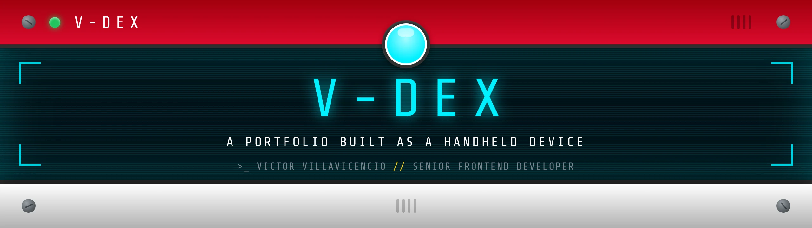
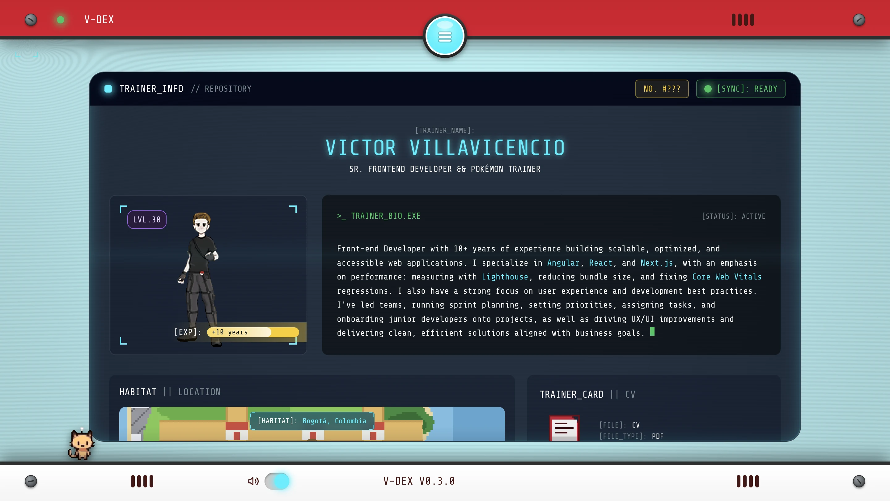
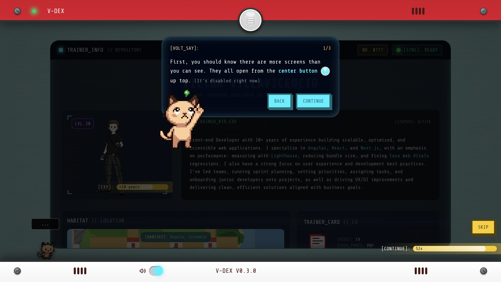
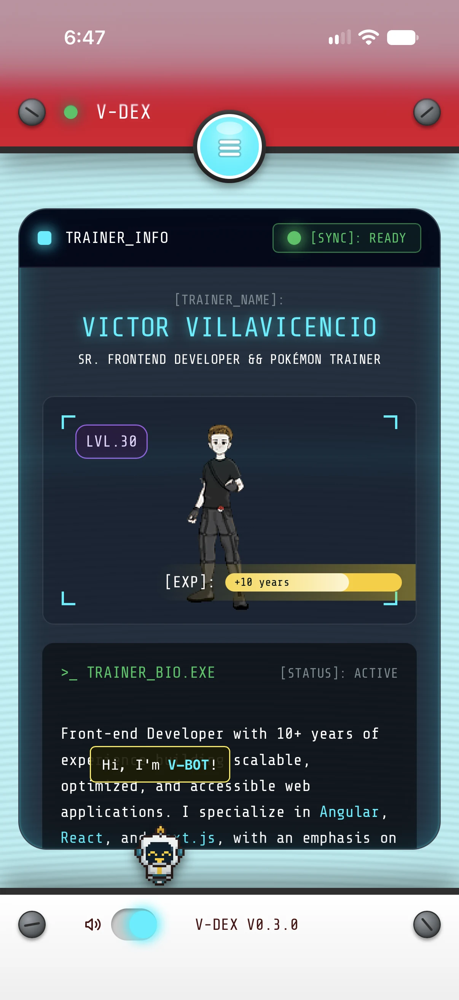
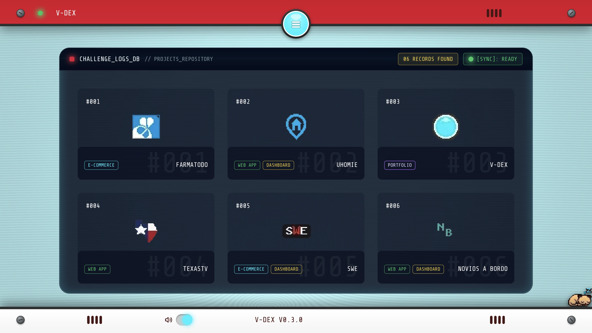
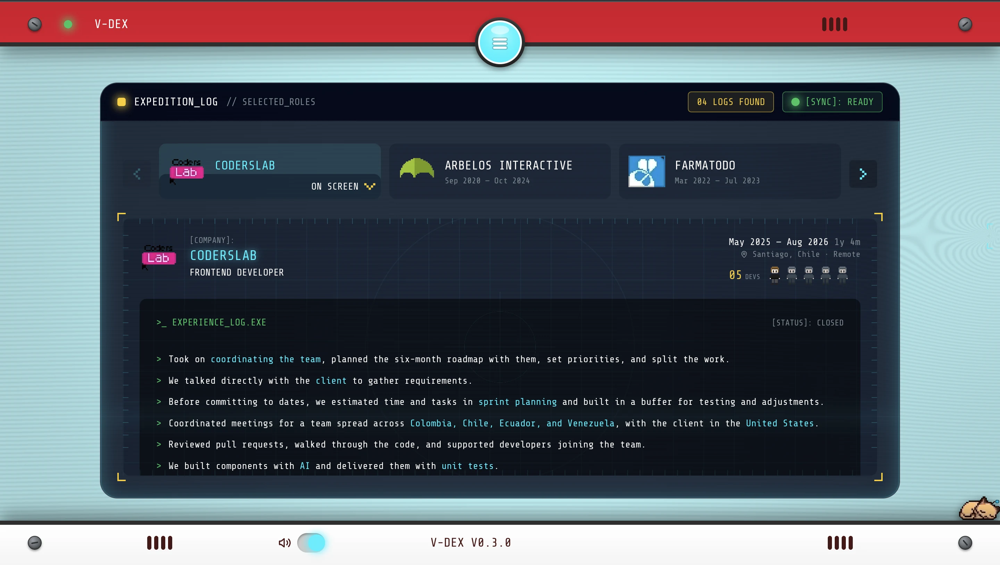
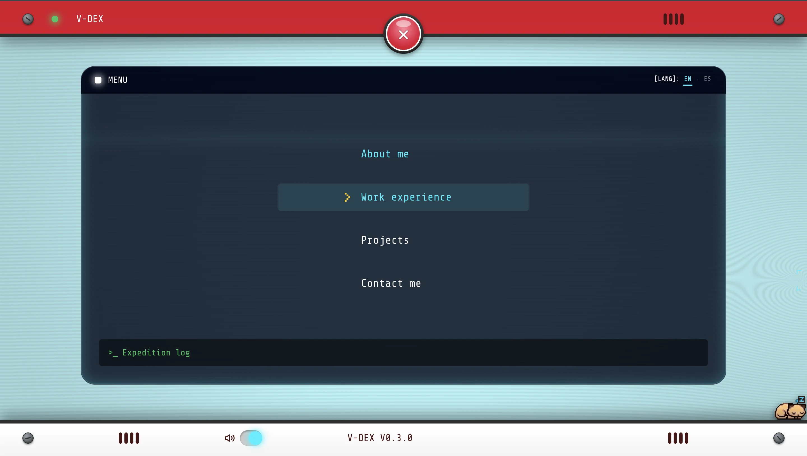
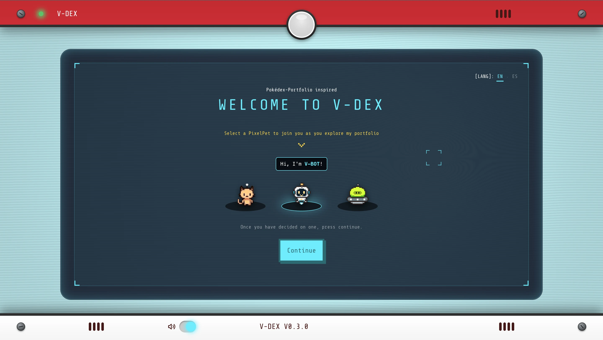

<p align="center">
  
</p>

<p align="center">
  <a href="https://v-dex.vercel.app"></a>
  <a href="https://github.com/Vrixton/v-dex/actions/workflows/ci.yml"></a>
  
  
  
  
  
</p>

A portfolio built as a handheld device. Two bezels close over the screen on
every navigation and open again when the view is ready, the sounds are
synthesized in the browser, and every sprite is pixel art drawn for this
project. It reads in English and Spanish, installs as an app, and the pet
living at the bottom of the screen is a package published to npm.

**100 in all four Lighthouse categories** on the home view. 103 unit tests.
No UI library, no animation library, no icon package, no audio files.



---

## Stack

Next.js (App Router) · React · TypeScript · Tailwind CSS v4 · pnpm · Vercel

The only runtime dependency that is not React or Next is
[`@vrixton/pixel-pet`](https://github.com/Vrixton/pixel-pet), which I wrote for
this project and publish separately.

---

## Architecture decisions

### 1. The bezels run on a state machine, not on animations

The device closes and opens around every navigation, and that sequence has
real steps: the chosen item blinks, the shutters close, the route is pushed,
the content renders, the shutters open. Doing that with timeouts scattered
across components meant the device could end up half closed, or open over a
view that had not loaded yet.

So the whole cycle lives in one reducer (`device-machine.ts`). Components
read the phase and render accordingly; they never decide what comes next.
Two consequences fall out of it for free: if the route is slow, the device
simply stays closed with the loader running instead of opening over an empty
screen, and when the viewer prefers reduced motion every duration collapses
to zero and the same machine runs instantly.

The timings live in one place too, and CSS reads them from a custom property
the provider sets, so the animation and the state machine cannot drift apart.

### 2. The pet is a published package, not a component

The pixel art pet is [`@vrixton/pixel-pet`](https://github.com/Vrixton/pixel-pet),
versioned on npm and consumed here like any third-party dependency. Extracting
it was not about reuse — there is one consumer. It was about forcing a boundary
I would otherwise have blurred.

Two decisions came out of that boundary and neither would have happened inside
the app. **Resting is controlled state**: where the pet sleeps lives in a cookie
owned by this app and enters the library as a prop, so the library stores
nothing and the position survives a reload without any hidden persistence.
And **a command is not a state**: the imperative `rest('nearest')` resolves the
closest edge at call time and reports back a concrete side, while the `resting`
prop only accepts absolute positions — so a consumer can never store a value it
would not know how to restore.

The library also carries the full ARIA menu pattern, a walk cycle whose frames
are driven by distance travelled rather than a separate clock, and a fix for a
CSS injection that an unescaped sprite path allowed during server rendering. It
runs 196 tests and is verified in Chromium, Firefox and WebKit.

Writing it as a package made the API the product. Inside the app it would have
been a component with ten props and no reason to justify any of them.

### 3. Every sound is synthesized in the browser

Eight sounds — hover, select, click, copy, badge, error, power, shutter —
and not a single audio file. They are oscillators and gain envelopes built
with the Web Audio API, under a kilobyte of code and zero network requests.

A sprite sheet of eight short samples would have been a few dozen kilobytes
and a handful of requests. Describing the sounds as code also made them
tunable: the badge chime is two sine waves an octave apart with an 80ms
hold, and changing its character is editing two numbers.

The audio context is only created after the first gesture, because browsers
block it before that.

### 4. The pixel art is drawn here, as sprite sheets

Project logos, company logos, badges, the trainer, the habitat map and the
cartridge are all drawn for this project and packed into sheets. The
project logo sheet is 288×32 and weighs 1.6 KB for six logos; the company
sheet is 522 bytes for five.

Taking brand assets from the web would have meant six separate files, no
control over how they look at this scale, and someone else's trademarks in
a personal project. Drawing them as pixel art solved all three at once and
matched the device.

Each sheet is one request, and positioning is a background offset.

### 5. Design tokens in two layers, with Tailwind's palette removed

`tokens.css` has primitives (the raw palette, on `:root`) and semantics
(named by intent, in `@theme inline`). Only the semantic layer generates
utilities.

`--color-*: initial` wipes Tailwind's default palette, so `bg-blue-500` does
not exist in this codebase. A component can only reach for `bg-screen`,
`text-fg-muted` or `border-brand-cyan` — names that say what the color is
for. Changing a primitive propagates everywhere; nothing can quietly bypass
the system.

### 6. The background renders on demand

The CRT backdrop is a WebGL shader, around 1 KB gzipped with no
dependencies. The first version ran a 60fps loop continuously for a slow
sweep nobody really noticed — waking the GPU sixty times a second for an
effect that was not there.

Now it draws only when something changes. At rest: zero draw calls. On
mobile and with reduced motion: one frame for the whole session. If the
context fails to create, the CSS background underneath is the same color
with the same scanlines, so nothing breaks.

### 7. Text lives in locale catalogs, and the validator never sees a word of it

The first version kept both languages next to the component that used them,
as `{ en, es }` objects. It worked, and it was wrong twice: a client
component holding both strings means the English visitor downloads the
Spanish copy too, and the site's text ended up spread across twenty files,
impossible to proofread in one pass.

Now `messages/en.ts` defines the shape and `es.ts` is typed against it, so a
missing key is a compile error. The server reads the active catalog and
hands the client only that one. Ids are derived from the catalog —
`SkillId`, `RoleId`, `ProjectId` — so a record without text cannot exist.

Written by hand rather than with `next-intl`. The locale segment, the
rewrite, the path helpers and the provider are about sixty lines, and the
library is the right answer on a product with translation vendors and
plural rules; this is two languages and one author. Knowing how it works
was worth more here than the dependency.

Validation returns error codes, not messages. `validateContact` runs in the
browser and in the route handler, and neither should know what language the
page is in: the form turns `tooShort` into text using the field's own
limit.

Four guards run in CI — a missing key, an empty string, a Spanish entry
identical to its English source (with a hand-written list of the few that
legitimately match), and a dropped `{placeholder}`. The last one is the
quiet bug: a translation that loses `{years}` still reads like a sentence,
just without the number.

---

## What testing changed

I put the device in front of people and watched. Two things came out of it,
and the first one was mine to get wrong.

**Three of ten testers took a long time to find the menu.** They went around
clicking the screws and the badges before reaching the one button that opens
every other screen. I started building a theory about affordances. Then I
measured the contrast: the white icon sat at **1.18:1** against the cyan
button, well under the 3:1 that WCAG asks of a control. It was not unclear,
it was invisible. A stroke in the device's own ink brought it up.

Whether that closed the gap is not settled. The sample was small and I have
not run the session again since the change. What I am sure about is the order
of operations: measure the thing that can be measured before building a theory
on top of it.

**Testers on the experience screen asked what they were reading.** The cards
sat above the detail panel with nothing tying them together. I reordered the
view, framed the open record, and pointed a marker from the active card down
at the panel it fills.

The first-run tour exists because of these sessions, not because a tour
seemed like a nice idea.



---

## Accessibility

- Every animation honors `prefers-reduced-motion`; the shutter cycle runs at
  zero duration rather than being skipped, so the state machine behaves the
  same way
- The device is fully operable by keyboard: the menu takes arrows, Home, End
  and Escape, and focus returns to the toggle on close
- Content is `inert` while the shutters are closed, so focus never lands
  behind them
- Floating labels are decorative; the accessible name lives in visually
  hidden text
- On touch, anything that depends on hover has a visible fallback
- Links that open a new tab say so in hidden text, added to the visible
  label rather than replacing it

---

## Installable

A web app manifest with `display: standalone`, so adding the site to a home
screen gives a handheld that opens without an address bar. The icons are
scaled from the 32px source artwork by whole multiples, so no pixel is
interpolated, and the maskable variant keeps the art at 75% for Android's
circular crop.

There is no service worker, on purpose. Offline support buys nothing for a
portfolio, and a cache that serves a stale build to a visitor costs more than
it saves.

<p align="center">
  
</p>

---

## Project structure

```
src/
  app/          Routes. Pages are server components; the device is the shell
  components/   Device chrome, window frame, sound, shared UI
  content/      Structured data: projects, roles, stack, skills. No prose
  features/     One folder per view
  i18n/         Locale routing, path helpers and the message catalogs
  lib/          Dates, validation, email, rate limiting
  hooks/        Reduced motion and other small hooks
  styles/       Tokens and keyframes
```

Data is kept out of components, and text is kept out of both. Adding a
project means one entry in `content/projects.ts` and its copy in each
catalog; both are typed, and the entry's id comes from the catalog, so a
project without text is a build error rather than an empty box in
production.

---

## The contact form

A route handler sends through Resend. The validation schema is shared
between client and server, so the rules cannot drift, and it returns error
codes rather than sentences, so neither side depends on the page's
language. The client check just saves a round trip.

Against bots: a hidden honeypot field and a minimum fill time. Against
abuse: a per-IP daily limit. The limit is in memory, which is not reliable
across serverless instances — it stops casual abuse, and a persistent store
is the upgrade path if it ever matters.

---

## Testing and CI

103 unit tests across 14 files, covering the device state machine, the boot
rules, the locale routing and path helpers, the contact schema, the sound
catalog, the date helpers and the message catalogs.

Every pull request and every push to `main` runs the same five checks, and
they have to pass before anything merges:

```bash
pnpm typecheck
pnpm lint
pnpm format:check
pnpm build
pnpm test
```

Commits go through commitlint and husky.

---

## Running it

```bash
pnpm install
pnpm dev
```

For the contact form, add a `.env.local`:

```
RESEND_API_KEY=
CONTACT_TO_EMAIL=
```

The rest of the site works without it.

---

## Screenshots

|                                             |                                                 |
| ------------------------------------------- | ----------------------------------------------- |
|  |  |
| The project catalog                         | The expedition log                              |
|          |        |
| Every screen opens from one button          | Choosing a PixelPet on the first visit          |

Built by [Victor Villavicencio](https://www.linkedin.com/in/vrixton/).
