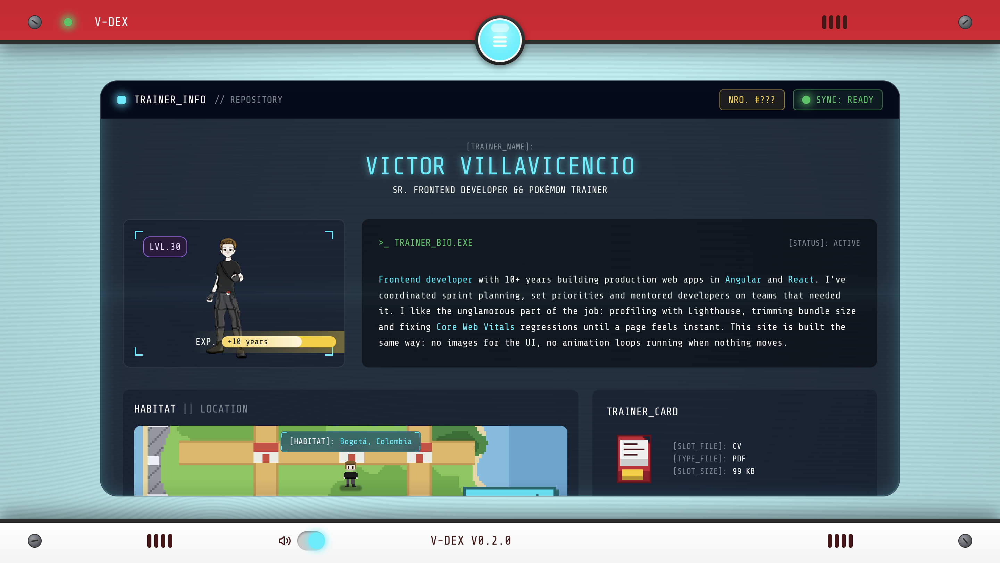
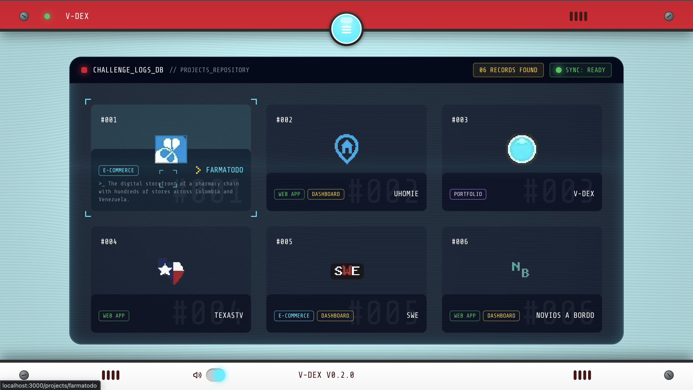
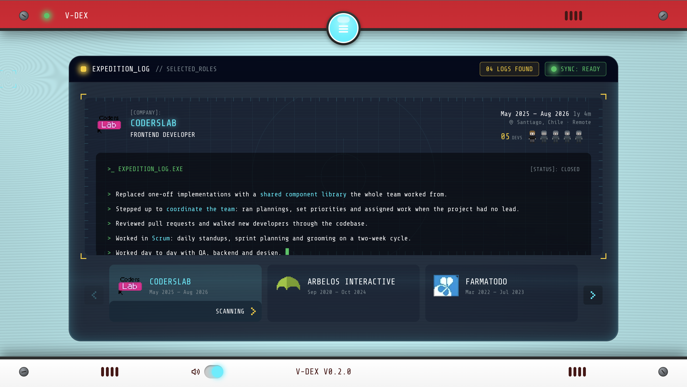

<p align="center">
  
</p>

<p align="center">
  <a href="https://v-dex.vercel.app"></a>
  
  
  
  
  
</p>

A portfolio built as a handheld device. Two bezels close over the screen on
every navigation and open again when the view is ready, the sounds are
synthesized in the browser, and every sprite is pixel art drawn for this
project.



---

## Stack

Next.js (App Router) · React · TypeScript · Tailwind CSS v4 · pnpm · Vercel

No UI library, no animation library, no icon package, no audio files.

---

## Architecture decisions

### 1. The bezels run on a state machine, not on animations

The device closes and opens around every navigation, and that sequence has
real steps: the chosen item blinks, the shutters close, the route is pushed,
the content renders, the shutters open. Doing that with timeouts scattered
across components meant the device could end up half closed, or open over a
view that had not loaded yet.

So the whole cycle lives in one reducer (`device-machine.ts`). Components
read the phase and render accordingly; they never decide what comes next.
Two consequences fall out of it for free: if the route is slow, the device
simply stays closed with the loader running instead of opening over an empty
screen, and when the viewer prefers reduced motion every duration collapses
to zero and the same machine runs instantly.

The timings live in one place too, and CSS reads them from a custom property
the provider sets, so the animation and the state machine cannot drift apart.

### 2. Every sound is synthesized in the browser

Eight sounds — hover, select, click, copy, badge, error, power, shutter —
and not a single audio file. They are oscillators and gain envelopes built
with the Web Audio API, under a kilobyte of code and zero network requests.

A sprite sheet of eight short samples would have been a few dozen kilobytes
and a handful of requests. Describing the sounds as code also made them
tunable: the badge chime is two sine waves an octave apart with an 80ms
hold, and changing its character is editing two numbers.

The audio context is only created after the first gesture, because browsers
block it before that.

### 3. The pixel art is drawn here, as sprite sheets

Project logos, company logos, badges, the trainer, the habitat map and the
cartridge are all drawn for this project and packed into sheets. The
project logo sheet is 288×32 and weighs 1.6 KB for six logos; the company
sheet is 522 bytes for five.

Taking brand assets from the web would have meant six separate files, no
control over how they look at this scale, and someone else's trademarks in
a personal project. Drawing them as pixel art solved all three at once and
matched the device.

Each sheet is one request, and positioning is a background offset.

### 4. Design tokens in two layers, with Tailwind's palette removed

`tokens.css` has primitives (the raw palette, on `:root`) and semantics
(named by intent, in `@theme inline`). Only the semantic layer generates
utilities.

`--color-*: initial` wipes Tailwind's default palette, so `bg-blue-500` does
not exist in this codebase. A component can only reach for `bg-screen`,
`text-fg-muted` or `border-brand-cyan` — names that say what the color is
for. Changing a primitive propagates everywhere; nothing can quietly bypass
the system.

### 5. The background renders on demand

The CRT backdrop is a WebGL shader, around 1 KB gzipped with no
dependencies. The first version ran a 60fps loop continuously for a slow
sweep nobody really noticed — waking the GPU sixty times a second for an
effect that was not there.

Now it draws only when something changes. At rest: zero draw calls. On
mobile and with reduced motion: one frame for the whole session. If the
context fails to create, the CSS background underneath is the same color
with the same scanlines, so nothing breaks.

---

## Accessibility

- Every animation honors `prefers-reduced-motion`; the shutter cycle runs at
  zero duration rather than being skipped, so the state machine behaves the
  same way
- The device is fully operable by keyboard: the menu takes arrows, Home, End
  and Escape, and focus returns to the toggle on close
- Content is `inert` while the shutters are closed, so focus never lands
  behind them
- Floating labels are decorative; the accessible name lives in visually
  hidden text
- On touch, anything that depends on hover has a visible fallback

---

## Project structure

```
src/
  app/          Routes. Pages are server components; the device is the shell
  components/   Device chrome, window frame, sound, shared UI
  content/      All copy and data as typed objects
  features/     One folder per view
  lib/          Dates, validation, email, rate limiting
  hooks/        Reduced motion and other small hooks
  styles/       Tokens and keyframes
```

Content is kept out of components on purpose: editing a project means
touching one file, and the shape is typed, so a missing field is a build
error rather than an empty box in production.

---

## The contact form

A route handler sends through Resend. The validation schema is shared
between client and server, so the rules cannot drift; the client copy just
saves a round trip.

Against bots: a hidden honeypot field and a minimum fill time. Against
abuse: a per-IP daily limit. The limit is in memory, which is not reliable
across serverless instances — it stops casual abuse, and a persistent store
is the upgrade path if it ever matters.

---

## Running it

```bash
pnpm install
pnpm dev
```

For the contact form, add a `.env.local`:

```
RESEND_API_KEY=
CONTACT_TO_EMAIL=
```

The rest of the site works without it.

### Checks

```bash
pnpm test        # unit tests
pnpm typecheck
pnpm lint
pnpm format:check
pnpm build
```

Commits go through commitlint and husky.

---

## Screenshots

|                                            |                                                |
| ------------------------------------------ | ---------------------------------------------- |
|  |  |
| The project catalog                        | The expedition log                             |

---

Built by [Victor Villavicencio](https://www.linkedin.com/in/vrixton/).
